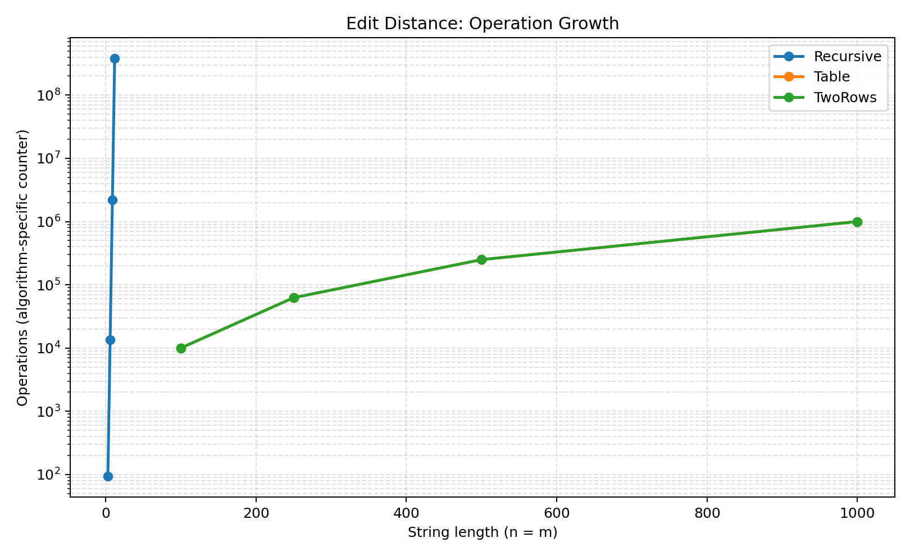
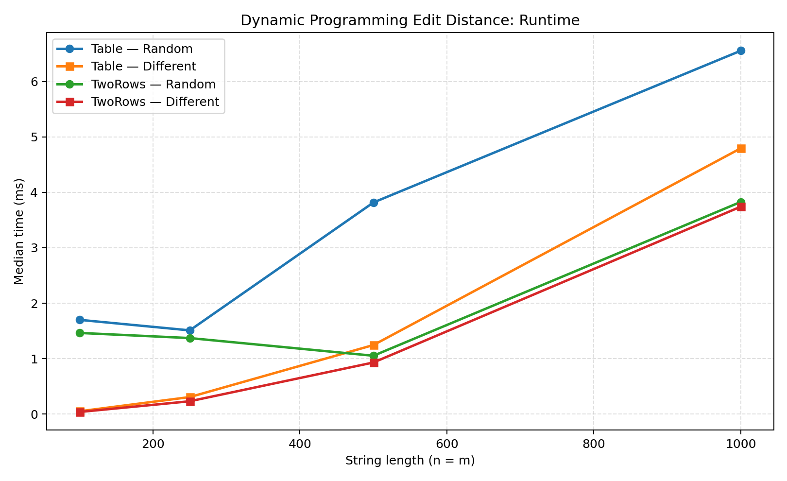
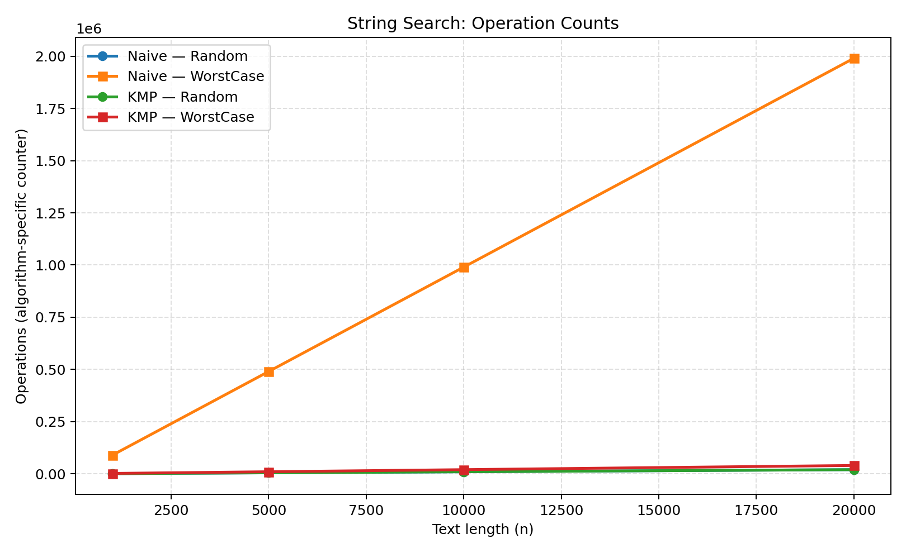
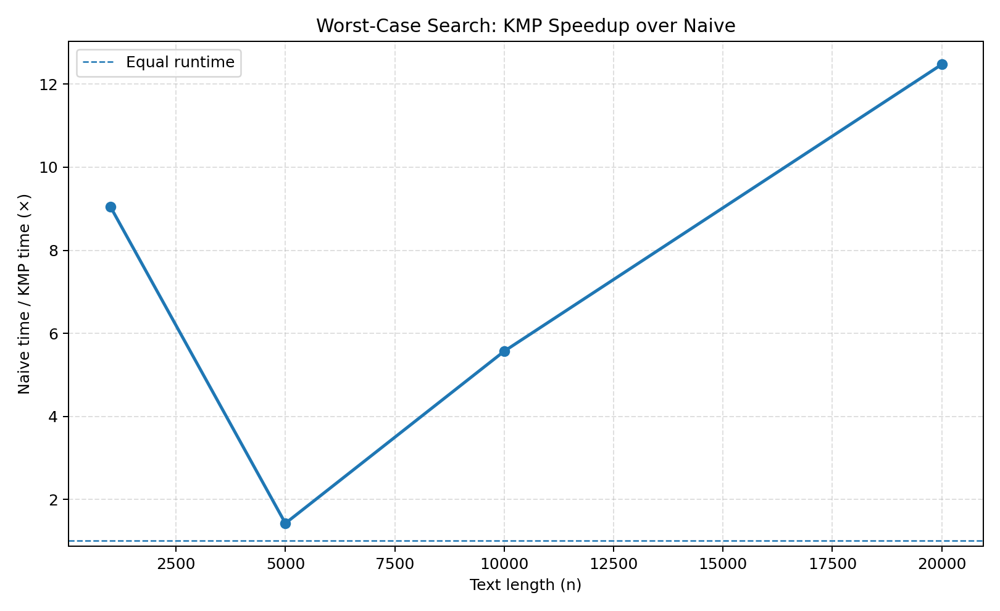

# Assignment 4 — Dynamic Programming and String Algorithms

## Experiment Design Card

| Item | Design |
|---|---|
| Goal | Compare three Edit Distance implementations and two exact string-search algorithms. |
| Environment | Java 17+ project; measurements were exported by the assignment's Java experiment runner. |
| Timing method | Median of 3 measured runs for each recorded configuration. |
| Reproducibility | Fixed pseudo-random seed: `42`. |
| Edit Distance inputs | Random strings and strings generated from different alphabets; DP sizes 100, 250, 500, 1000. Naive recursion sizes 3, 6, 9, 12. |
| String Search inputs | Random text and an adversarial repeated-character text; text sizes 1,000, 5,000, 10,000, 20,000. |
| Pattern sizes | 20 for random search; up to 100 for worst-case search. |
| Counters | Algorithm-specific operation counters; their exact meanings differ by algorithm (see Notes). |
| Output | `results/results.csv` and four PNG plots in `results/plots/`. |

## 1. Implemented algorithms

### Edit Distance
- **Recursive**: directly evaluates the recurrence without memoization. Its running time grows exponentially, so only small input sizes were tested.
- **Table**: bottom-up dynamic programming with a full \\( (n+1) \\times (m+1) \\) table. Time complexity: \\(O(nm)\\); memory: \\(O(nm)\\).
- **TwoRows**: uses the same recurrence but stores only the previous and current rows. Time complexity: \\(O(nm)\\); extra memory: \\(O(\\min(n,m))\\).

### String Search
- **Naive**: checks the pattern at every possible starting position. Worst-case time: \\(O(nm)\\).
- **KMP**: preprocesses the pattern with the LPS (longest proper prefix which is also a suffix) array and reuses previous matches. Time: \\(O(n+m)\\), with \\(O(m)\\) extra memory.

## 2. Results and plots

### Edit Distance — operation growth

The recursive implementation reaches **377,393,953 counted recursive calls** at length 12 and takes **811.5233 ms**. This sharp growth demonstrates why naive recursion is unsuitable for long strings. Both dynamic-programming versions perform exactly \\(n\\cdot m\\) inner-cell updates in the measured square cases: 1,000,000 updates at length 1,000.

### Edit Distance — runtime

At length 1,000 with random input, the recorded medians were:
- Table: **6.5531 ms**
- TwoRows: **3.8270 ms**

For the different-alphabet input at length 1,000:
- Table: **4.7942 ms**
- TwoRows: **3.7410 ms**

The two-row implementation uses much less memory while preserving the same asymptotic running time and operation count. Small timing differences should not be interpreted as a universal speed advantage: runtime is affected by JVM warm-up, garbage collection, and machine load.

### String Search — operation counts

The worst-case input is deliberately constructed from repeated `A` characters, with a pattern consisting mostly of `A` characters and ending in `B`. This forces the naive algorithm to re-check many characters at adjacent positions. KMP avoids repeating that work by using the LPS table.

At text length 20,000, the counters were:
- Naive, worst case: **1,990,100**
- KMP, worst case: **40,098**

### Worst-case runtime ratio

At text length 20,000, Naive took **3.3535 ms**, while KMP took **0.2688 ms**. The measured Naive/KMP ratio was **12.48×**. The ratio is shown rather than only raw times to make the relative difference easier to see.

## 3. Discussion and answers

**1. Which string-search input is harder, and why?**  
The worst-case repeated-character input is harder for Naive. Many candidate alignments match a long prefix and fail only at the final character, so the same text characters are compared repeatedly. KMP uses LPS information to skip those redundant comparisons.

**2. Why was the recursive Edit Distance tested only on small strings?**  
The naive recursive recurrence branches into deletion, insertion, and substitution when the final characters differ. Without memoization, many subproblems are recalculated. The measured counter already reaches 377,393,953 calls at length 12, and the runtime rises sharply. Larger inputs would be impractical for this experiment.

**3. What is the trade-off between Table and TwoRows?**  
Both perform \\(O(nm)\\) work. The full table stores every DP cell, requiring \\(O(nm)\\) memory; it is useful if the complete table or an edit sequence must be reconstructed. TwoRows stores only two rows, reducing extra memory to \\(O(\\min(n,m))\\), which is preferable when only the distance is required.

**4. Which string-search algorithm is preferable for large or repetitive inputs?**  
KMP is the safer general choice for large inputs because its worst-case time is linear, \\(O(n+m)\\). Naive search is simpler and can be competitive on small/random inputs, but it has a quadratic worst case.

## 4. Prediction versus observation

The expected theoretical behavior was: exponential growth for naive recursive Edit Distance; quadratic cell work for both DP variants; potentially quadratic work for Naive search on repetitive input; and linear work for KMP. The operation counters support these expectations. In particular, at text length 20,000, the worst-case Naive counter is **1,990,100**, compared with **40,098** for KMP. Wall-clock measurements generally follow the expected trends, but individual timings are noisy and should be treated as empirical observations rather than proofs of complexity.

## 5. Notes on measurement

The CSV records the median of three timing runs. The operation counter is algorithm-specific: Recursive counts recursive calls; the DP implementations count inner DP-cell updates; Naive counts character comparisons; KMP counts comparisons made during LPS preprocessing and text scanning. Therefore, counters are meaningful for comparing growth within an algorithm or comparing the two search methods with the stated definition, but they are not a universal common unit of work. The random-search timings are particularly small and fluctuate between sizes, so conclusions rely more heavily on operation counts and the deliberately adversarial case than on a single timing point.

## 6. Conclusion

The experiments demonstrate the practical value of dynamic programming and preprocessing. For Edit Distance, bottom-up DP avoids the explosive recomputation of naive recursion, and TwoRows reduces memory without changing the time complexity. For exact string search, KMP is robust on repetitive worst-case inputs because it avoids rechecking already matched prefixes. The choice between full-table and two-row DP depends on whether the full table is needed; for search, KMP is the stronger choice when predictable performance matters.
